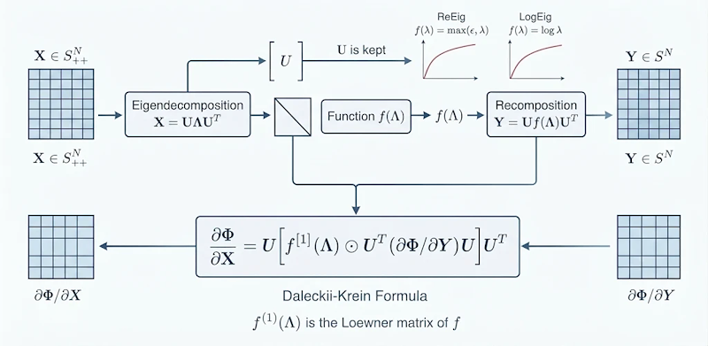

<p align="center">
  
</p>


<a href="https://Marco-Congedo.github.io/ChainRulesSPD.jl/dev">
  
</a>

---

# ChainRulesSPD

This package implements primal function and backpropagation rules for Riemannian neural networks on the manifold
of symmetric definite matrices.

---

## 🔗 Reference

Congedo M. Bouchard F. and Bhatia R. (2026) A new look at the Riemannian manifold of positive definite matrices,
*Transactions on Machine Learning research*.

---

## 🧩 Requirements 

**Julia**: version ≥ 1.13

---

## ⚙️ Installation

```julia
using Pkg
Pkg.add("ChainRulesSPD")
```

---

## ✍️ About the Author

[Marco Congedo](https://sites.google.com/site/marcocongedo), corresponding author, is a Research Director of [CNRS](http://www.cnrs.fr/en) (Centre National de la Recherche Scientifique), working at [UGA](https://www.univ-grenoble-alpes.fr/english/) (University of Grenoble Alpes). 

--- 

<a href="https://Marco-Congedo.github.io/ChainRulesSPD.jl/dev">
  
</a>

